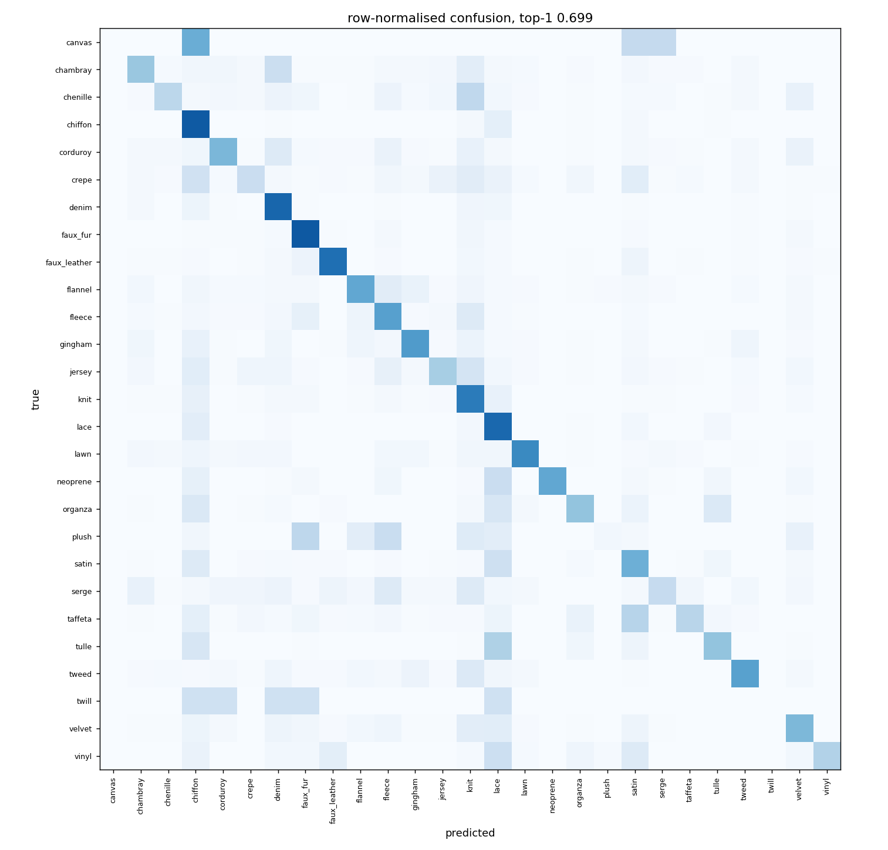

# Fabric, 27 classes: frozen DINOv2 + linear head vs the ViT-Tiny baseline

_2026-10-24. Domain: catalog (TextileNet archive images). Every number below was measured
in this run unless it is marked as the teammate's (from `05_kaggle_log_analysis.md` and
`06_fastfix_results.md` on branch `origin/cursor/push-reports-05-06`)._

## 1. Answer

A frozen DINOv2 ViT-B/14 with a linear head, trained with ordinary cross-entropy and
ordinary sampling for 20 epochs, **beats the baseline on macro F1 and on accuracy** on the
baseline's own test set:

| Archive test, n = 24,628 | top-1 | macro F1 | weighted F1 | balanced acc. |
|---|---|---|---|---|
| Baseline ViT-Tiny, 20 ep (teammate) | 0.6923 | 0.4662 | 0.6796 | 0.4400 |
| ViT-Tiny + sqrt class-weighted CE (teammate) | 0.6636 | 0.4630 | 0.6690 | 0.4957 |
| ViT-Tiny + inverse sampler, 4 ep (teammate) | 0.5165 | 0.3647 | 0.5567 | 0.4966 |
| **DINOv2 linear, plain CE** (recommended) | **0.6986 ± 0.0006** | 0.4896 ± 0.0027 | **0.6909 ± 0.0006** | 0.4613 ± 0.0026 |
| DINOv2 linear, sqrt sampler | 0.6795 ± 0.0009 | **0.4900 ± 0.0009** | 0.6856 ± 0.0012 | 0.5194 ± 0.0010 |
| DINOv2 linear, inverse sampler | 0.6207 ± 0.0025 | 0.4472 ± 0.0023 | 0.6442 ± 0.0025 | **0.5373 ± 0.0033** |

Mean ± std over seeds 0, 1, 2. Plain CE: macro F1 **+0.023**, top-1 **+0.6 pts** over the
baseline. The gain is modest and comes almost entirely from mid-frequency and frequent
classes; canvas and twill stay at F1 = 0 under every configuration (section 5).

- **Sqrt sampling** ties plain CE on test macro F1 (0.4900 vs 0.4896, inside seed noise),
  loses on val macro F1 (0.5268 vs 0.5296, the pre-declared selection metric), costs 1.9
  pts of top-1 (dropping below the baseline's accuracy), and buys +5.8 pts balanced
  accuracy and +10.6 pts minority recall. It's the right choice only if rare-class recall
  is worth that accuracy.
- **Inverse sampling** is worse on macro F1 even with the full 20-epoch budget (0.4472):
  on this head, full inverse rebalancing costs more precision on frequent classes than it
  gains in rare-class recall. That doesn't settle the end-to-end ViT-Tiny case, but the
  short schedule doesn't explain the gap here.

## 2. What was held fixed, what varied

| | |
|---|---|
| Split | `data/splits/prelim/fabric.csv`, the frozen split the baseline used. Verified identical by class counts: train canvas 11, twill 28; archive test 24,628 (canvas 4, twill 5, plush 57, neoprene 60, jersey 228, lace 6,913). |
| Train / val / test | 85,272 / 9,474 / 24,628 archive images. Val selects everything; test was evaluated once per seed, after selection. |
| Backbone | `vit_base_patch14_dinov2.lvd142m` (timm), frozen, 224 px, centre crop. |
| Feature | `[CLS ; mean(patch tokens)]`, 1,536-d, standardised with train mean/std (the DINOv2 linear-eval recipe; cached in `data/features/fabric/dinov2_vitb14_224`). |
| Head | One `Linear(1536, 27)`. AdamW, batch 1,024, 10% warmup then cosine, label smoothing 0.1, **20 epochs** (the baseline's budget). |
| lr / weight decay | Chosen per condition on val macro F1 from the shared grid {1e-3, 3e-3} × {1e-4, 1e-3, 1e-2, 5e-2}. All three conditions picked lr 3e-3 (wd 0.01 for CE, 0.05 for the samplers; wd barely matters, ±0.001). |
| Checkpoint | The epoch with the best **val macro F1** (CE: epochs 13–15; sqrt: 14–19; inverse: 15–18). |
| **Only variable** | The sampler: none (shuffle), sqrt (class weight count^-0.5), inverse (count^-1). The sqrt and inverse runs draw n samples with replacement per epoch, as `WeightedRandomSampler` does. No class-weighted loss anywhere. |

Minority recall here is the mean test recall over the 10 classes that hold under 1% of
the train images: canvas, twill, vinyl, neoprene, plush, serge, taffeta, chenille, lawn,
jersey. The teammate's reports don't state their minority set, so their 0.1634 / 0.2556 /
0.405 are **not directly comparable** with ours (CE 0.269, sqrt 0.375, inverse 0.423).
Use the per-class table instead.

On the full prelim test (n = 40,970, archive plus web-scraped images), the ranking is the
same and the gap between samplers widens: CE 0.7180 / 0.4849, sqrt 0.6911 / 0.4725,
inverse 0.6254 / 0.4266 (top-1 / macro F1).

## 3. Training curves (seed 0, val)

| | ep 0 | ep 4 | ep 9 | ep 14 | ep 19 |
|---|---|---|---|---|---|
| CE: val macro F1 / val loss | 0.402 / 1.336 | 0.475 / 1.121 | 0.504 / 1.085 | 0.519 / 1.057 | 0.520 / 1.049 |
| sqrt | 0.440 / 1.412 | 0.494 / 1.216 | 0.505 / 1.178 | 0.529 / 1.131 | 0.513 / 1.126 |
| inverse | 0.386 / 1.661 | 0.451 / 1.446 | 0.449 / 1.385 | 0.469 / 1.338 | 0.476 / 1.315 |

CE has flattened by epoch 14; more epochs wouldn't help a linear head on frozen features.
Full per-epoch train loss, val loss, top-1, macro and weighted F1 and balanced accuracy are in
`runs/imbalance/fabric/<tag>/seed<k>/log.jsonl`.

## 4. Per class (archive test, mean over seeds: precision / recall / F1)

| class | train n | test n | plain CE | sqrt | inverse | baseline F1 (teammate) |
|---|---|---|---|---|---|---|
| canvas | 11 | 4 | 0.00 / 0.00 / 0.00 | 0.00 / 0.00 / 0.00 | 0.00 / 0.00 / 0.00 | 0.000 |
| twill | 28 | 5 | 0.00 / 0.00 / 0.00 | 0.00 / 0.00 / 0.00 | 0.00 / 0.00 / 0.00 | 0.000 |
| vinyl | 142 | 46 | 0.67 / 0.31 / 0.42 | 0.43 / 0.59 / 0.50 | 0.26 / 0.66 / 0.37 | |
| neoprene | 157 | 60 | 0.90 / 0.53 / 0.66 | 0.50 / 0.68 / 0.58 | 0.25 / 0.71 / 0.37 | 0.633 |
| plush | 181 | 57 | 0.23 / 0.03 / 0.05 | 0.16 / 0.18 / 0.17 | 0.08 / 0.26 / 0.12 | 0.034 |
| serge | 474 | 127 | 0.38 / 0.25 / 0.30 | 0.24 / 0.33 / 0.28 | 0.15 / 0.35 / 0.21 | |
| taffeta | 726 | 197 | 0.58 / 0.29 / 0.39 | 0.37 / 0.42 / 0.40 | 0.26 / 0.53 / 0.35 | |
| chenille | 727 | 207 | 0.50 / 0.28 / 0.36 | 0.36 / 0.42 / 0.39 | 0.30 / 0.51 / 0.37 | |
| lawn | 835 | 209 | 0.66 / 0.66 / 0.66 | 0.54 / 0.68 / 0.60 | 0.45 / 0.69 / 0.54 | |
| jersey | 841 | 228 | 0.44 / 0.35 / 0.38 | 0.33 / 0.44 / 0.38 | 0.25 / 0.51 / 0.33 | 0.187 |
| corduroy | 908 | 265 | 0.56 / 0.46 / 0.50 | 0.48 / 0.55 / 0.51 | 0.40 / 0.60 / 0.48 | |
| crepe | 920 | 239 | 0.33 / 0.23 / 0.27 | 0.24 / 0.35 / 0.28 | 0.17 / 0.43 / 0.24 | |
| chambray | 1031 | 294 | 0.44 / 0.39 / 0.41 | 0.38 / 0.51 / 0.43 | 0.31 / 0.56 / 0.40 | |
| flannel | 1083 | 292 | 0.57 / 0.53 / 0.55 | 0.51 / 0.57 / 0.54 | 0.47 / 0.59 / 0.52 | |
| tweed | 1095 | 292 | 0.63 / 0.56 / 0.59 | 0.52 / 0.60 / 0.56 | 0.45 / 0.62 / 0.52 | |
| faux_leather | 1237 | 331 | 0.76 / 0.76 / 0.76 | 0.70 / 0.78 / 0.74 | 0.65 / 0.81 / 0.72 | |
| gingham | 1300 | 380 | 0.67 / 0.58 / 0.62 | 0.60 / 0.62 / 0.61 | 0.53 / 0.62 / 0.57 | |
| fleece | 2045 | 562 | 0.51 / 0.56 / 0.54 | 0.52 / 0.55 / 0.53 | 0.50 / 0.54 / 0.52 | |
| organza | 2073 | 601 | 0.59 / 0.40 / 0.48 | 0.46 / 0.48 / 0.47 | 0.35 / 0.53 / 0.42 | |
| velvet | 2315 | 675 | 0.59 / 0.45 / 0.51 | 0.54 / 0.48 / 0.51 | 0.44 / 0.49 / 0.46 | |
| tulle | 2693 | 756 | 0.45 / 0.40 / 0.42 | 0.38 / 0.53 / 0.44 | 0.31 / 0.66 / 0.42 | 0.358 |
| faux_fur | 4351 | 1178 | 0.81 / 0.84 / 0.82 | 0.82 / 0.82 / 0.82 | 0.84 / 0.78 / 0.81 | |
| satin | 5178 | 1484 | 0.55 / 0.49 / 0.52 | 0.52 / 0.51 / 0.52 | 0.48 / 0.47 / 0.47 | |
| denim | 5573 | 1711 | 0.77 / 0.79 / 0.78 | 0.80 / 0.76 / 0.78 | 0.83 / 0.72 / 0.77 | |
| knit | 6747 | 1829 | 0.60 / 0.71 / 0.65 | 0.63 / 0.67 / 0.65 | 0.64 / 0.61 / 0.62 | |
| chiffon | 19427 | 5686 | 0.75 / 0.84 / 0.79 | 0.79 / 0.79 / 0.79 | 0.81 / 0.69 / 0.75 | 0.781 |
| lace | 23174 | 6913 | 0.77 / 0.78 / 0.78 | 0.83 / 0.71 / 0.76 | 0.87 / 0.59 / 0.70 | 0.784 |

The pattern is the same one the teammate saw with class weights: every step of rebalancing
moves recall into the rare classes and precision out of them, and lace/chiffon recall pays
for it. Sqrt helps where a class is rare but visually coherent (vinyl, plush, taffeta,
chenille, tulle) and hurts where the plain head was already precise (neoprene, lawn).



## 5. Error analysis

**Most confused pairs** (plain CE, archive test, rate of the true class): canvas→chiffon
0.50 (2 of 4), taffeta→satin 0.28, tulle→lace 0.28, plush→faux_fur 0.26, plush→fleece
0.26, chenille→knit 0.26, chambray→denim 0.23, vinyl→lace 0.22. These are the same
look-alike pairs the baseline confused (taffeta→satin 0.29, tulle→lace 0.44, chenille→knit
0.27): sheer-vs-lace and sheen-vs-sheen distinctions that generic frozen features don't
separate.

**Canvas and twill can't be fixed by sampling.** A label audit in DINOv2 feature space
(cosine on standardised features; every archive image against every train image):

- kNN-10 label purity, the share of a train image's 10 nearest other train images that
  share its label: **twill 0.03, canvas 0.15**, plush 0.07, vinyl 0.11, jersey 0.13, crepe
  0.12. Frequent classes sit at 0.64–0.74. Twill train images almost never resemble each
  other.
- Canvas: 4 of the 11 train images form one tight cluster (each other's nearest
  neighbours, cosine ~0.69) and a 5th joins it more loosely (0.57). The other 6 have no
  canvas image among their 10 nearest neighbours: they sit with denim, lace, faux fur and
  tweed. **None of the 4 canvas test
  images** has a canvas train image among its 10 nearest neighbours; theirs are crepe,
  chiffon and lawn.
- Twill: the few coherent twill train images sit inside denim. That's a real class overlap,
  since denim *is* a twill weave. Most of the others sit with chiffon, lace, faux fur or
  tweed. None of the 5 twill test images has a twill train neighbour; theirs are denim,
  chambray and lace.

Oversampling 11 canvas features 2,000 times per epoch teaches the head those 11 points
and nothing about the 4 test images, which look different. Sampling can't make up for that.
Fixing it takes new canvas and twill images, an audit of the existing labels, or folding
twill into denim (or into a "twill weave" family) for the scanner.

**Overlapping labels.** 2,703 near-duplicate neighbour pairs (cosine ≥ 0.95) carry
different labels: chiffon↔lace 1,354, lace↔satin 328, lace↔tulle 189, chiffon↔tulle 110,
organza↔tulle 77, faux_fur↔plush 40, chambray↔denim 17. Example: test chiffon
`120306_imaterial.jpeg` sits at cosine 0.97 to a lace train image. Many iMaterialist
photos show whole garments with more than one fabric (a chiffon dress with lace trim), so
one image-level label is ambiguous. This puts a ceiling on lace/chiffon/tulle/satin
accuracy that no model change removes.

**Caveat: near-duplicate leakage.** The split removed byte-identical train/test copies,
but val and test images still have 6,408 neighbour hits on a same-label train image at
cosine ≥ 0.95 (resized or recompressed copies). This inflates every model on this split,
the baseline included. It doesn't change the comparison, but absolute numbers are
optimistic. Re-splitting would break comparability with the baseline, so it wasn't done here.

## 6. Tried and rejected (exploratory; not committed)

**Post-hoc logit adjustment** (`logits − τ·log prior`, τ ∈ [0, 1.5] picked on val macro
F1): val picked τ = 0 in 5 of 6 heads (CE and sqrt, 3 seeds each), and τ = 0.15 once. No
gain, so it isn't in the pipeline.

## 7. Not run yet: Albumentations + LoRA (needs the images and a GPU)

The frozen runs above use cached centre-crop features, so they have **no augmentation**.
Augmenting a frozen backbone means re-running it on every augmented view, and that needs
the images (13 GB, on the team Drive) and a GPU. This Mac is a fanless laptop, so those
runs belong on Kaggle or a rented GPU.

`train.py` already has the Albumentations pipeline, applied to train only (val and test
get resize + centre crop + normalise): RandomResizedCrop (scale 0.35–1), horizontal and
vertical flip, RandomRotate90, mild affine, brightness/contrast/saturation jitter (±0.2 /
0.2 / 0.15, hue ±0.02), one of mild blur / Gaussian noise / JPEG, CLAHE (p 0.1),
CoarseDropout (p 0.3), Normalize. It was kept unchanged: the teammate's runs appear to
use this `train.py` (their run tags match its `--sampler` / `--class-weighted-loss` flags),
so changing the augmentation would break the comparison.

This branch adds what the comparison needs:

- `--lora-rank r` (plus `--lora-alpha`): freezes the backbone and wraps every attention
  q/k/v projection (`blocks.*.attn.qkv`, 12 layers) in LoRA. B starts at zero, so training
  starts from exactly the pretrained model. Rank 8 trains 315,675 parameters (adapters +
  head) of 86 M. `best.pt` holds the LoRA-merged weights under timm's own keys, so Head A
  export and serving load it unchanged, and the final test runs on exactly those weights.
- `--select macro_f1`: checkpoint, raw vs EMA, TTA and early stopping all follow val
  macro F1. Per-epoch val loss, weighted F1 and balanced accuracy are logged.
  `test_metrics.json` gains `test_by_source` (archive = the baseline's test set) and
  minority recall.

Verified only as a smoke test (2 steps on synthetic images, on MPS); **no LoRA accuracy
has been measured**. The controlled pair, identical except for the adapters:

```bash
# B0: frozen DINOv2 + linear head WITH augmentation (the control)
python -m training.textilenet.train --partition fabric --model dinov2_vitb14 \
  --split-csv data/splits/prelim/fabric.csv --epochs 20 --select macro_f1 \
  --layer-decay 1.0 --probe-epochs 20 --tag dinov2_frozen_aug --seed 0
# B1: + LoRA r=8 on attention q/k/v
python -m training.textilenet.train --partition fabric --model dinov2_vitb14 \
  --split-csv data/splits/prelim/fabric.csv --epochs 20 --select macro_f1 \
  --layer-decay 1.0 --lora-rank 8 --tag dinov2_lora8_aug --seed 0
```

Read `test_by_source.archive` against section 1. Estimated, not measured: about 3 h (B0)
and 4–5 h (B1) on one T4, limited by JPEG decoding. The lr is the train.py default (1e-4 per 64 images,
head ×10) and is **untuned**. If B1 underfits, try `--lr 3e-4` on val before touching test.
B0 differs from the cached probe in two ways (augmentation, and timm's CLS-token head
instead of `[CLS ; mean patch]`), so compare LoRA against B0, not against section 1.

## 8. Recommendation

1. **Use frozen DINOv2 ViT-B/14 + linear head, plain CE, ordinary sampling, 20 epochs,
   checkpoint on val macro F1.** It's the only configuration measured here that beats the
   baseline on both macro F1 (0.4896 vs 0.4662) and top-1 (0.6986 vs 0.6923), a seed
   trains in about 3 s from the feature cache, and it's stable across seeds (std ≤ 0.003).
2. Switch to the **sqrt sampler** only if rare-class recall matters more than about 2
   pts of accuracy. Don't use inverse sampling.
3. The next real gains are **data**, not sampling: canvas and twill need new images or a
   relabel/merge, and the chiffon/lace/tulle/satin labels need a multi-fabric policy.
4. Run the LoRA pair (section 7) when a GPU is available; it targets the look-alike
   confusions, which are the largest remaining error mass.

## 9. Reproduce

```bash
for s in none sqrt inverse; do  # under a minute each on an M3 once the cache is warm
  python -m training.textilenet.probe --partition fabric \
    --split-csv data/splits/prelim/fabric.csv --epochs 20 --select macro_f1 \
    --sampler $s --tag dinov2_linear_$([ $s = none ] && echo ce || echo $s) --out runs/imbalance
done
```

Each `runs/imbalance/fabric/<tag>/seed<k>/` holds `test_metrics.json` (test, test_by_source,
per-class precision/recall/F1, confusion matrix, minority recall), `log.jsonl`, `head.pt`
(head + feature standardisation) and `confusion.png`.
