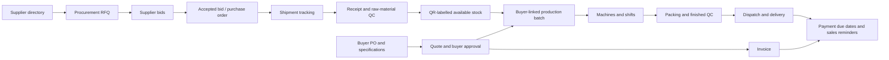

# Yarnflow procurement, production and sales implementation plan

Date: 28 October 2026. Status: implementation planning only, explicitly confirmed by the user; application functionality below is not yet built or deployed.

Implementation update: the user subsequently authorized implementation and pushing/publishing the verified first release. The target plan below includes future modules; released features are recorded in `docs/releases/2026-10-28-procurement.md`.

Confirmed requirements: supplier portal registration/login with admin approval; supplier supplies the B/L at shipment dispatch; DataLoopLabs is the selected tracking provider and the user already has its API key. Parallel OpenCode 2 work is for planning/review only, supervised every 30 minutes.

## 1. Outcome and scope

One factory workspace connects three operational areas: **Procurement**, **Production**, and **Sales**. Inventory, quality, contacts, documents, notifications and permissions are shared services. Every finished batch is traceable back to the buyer order, production runs and raw-material lots used.

The initial release assumes one accepted supplier bid per procurement RFQ. Partial receipts and partial buyer dispatches are supported. Split awards, supplier payments/accounting, bank integrations and automatic machine telemetry are later scope unless explicitly added. Production progress initially comes from authorized shift entries.

## 2. Existing foundation to reuse

- React/TypeScript UI, English/Urdu translation and mobile layouts in `src/LiveApp.tsx`, `src/i18n.tsx`, `src/yarnflow.css`.
- Cloudflare Worker API in `server/inventory.mjs` and `server/cloudflare.mjs`; D1 schema in `drizzle/0000_inventory.sql` and `0001_users.sql`.
- Products, lots, QR batch labels, raw/WIP/finished stock, immutable movements/reversals, nonnegative balances, QC history and inspection evidence already exist.
- Accounts currently have `admin`/`member` plus eight permissions. Extend this system with named role presets and domain permissions; do not infer authorization from a hidden button.
- TexPilot evidence remains supporting evidence. A scan alone never releases a QC hold.
- Current uncommitted UI/session work and active scanner must be preserved. New implementation uses isolated worktrees and additive migrations. Do not deploy an unrelated worker's unfinished tree.

## 3. Product flows

### Procurement and suppliers

1. Show suppliers under the six requested categories: Pure Cotton; Blended (PC/CVC/PV); Synthetic and Filament; Fancy and Speciality; Processed and Dyed; Sustainable and Eco-Friendly. A supplier can belong to several categories.
2. Supplier profile contains company name, city, contact person/department, normalized phone, email, website, product capabilities, verification source/date and active status. The Call action uses an E.164 `tel:` link; the device opens its available calling handler. The app does not claim a call connected.
3. Purchase manager creates one RFQ with category, yarn count, composition, specification, quantity/unit, delivery location/date, bid deadline, attachments and commercial requirements.
4. Review recipients, then Send to all active eligible suppliers. Persist the recipient snapshot and one delivery record per supplier. Eligibility includes category plus required capability filters. Retry failures without duplicating successful invitations.
5. Confirmed supplier portal: suppliers register and log in; admin approves new registrations before operational access. Registration captures organization, contact, verified email, credentials and requested categories. States are `email_unverified -> pending_approval -> approved`, with `rejected` and `suspended` branches. Login for pending applicants shows approval status only; it cannot read RFQs, submit bids, post dispatches or inspect factory data. Email verification does not equal admin approval. Use secure password hashing and expiring server sessions or a suitable managed identity provider; do not reuse internal four-digit PINs for external supplier authentication. Rate-limit registration/login/recovery and audit admin approvals, rejection and suspension. Revoke operational sessions/grants upon suspension.
6. Category membership and company identity are admin-reviewed. Existing directory entries must be matched through a verified claim workflow so a registrant cannot impersonate an existing supplier or create duplicate recipient identities. Approved supplier users see only RFQs addressed to their organization and their own bids, orders and shipments. Portal inbox notification is the authoritative RFQ delivery; optional email alerts link back to authenticated portal pages and need a configured sender before real sending. An invitation token can locate an invitation, but does not bypass registration/approval or authorize a bid.
7. Supplier submits price, currency, price basis, offered quantity, taxes/freight, delivery lead time/date, payment terms, quote validity and documents. Edits create bid revisions.
8. Purchase manager compares equivalent units and full costs, accepts one current bid or rejects with a reason. Acceptance atomically closes competing award attempts and creates a supplier purchase order with a frozen terms snapshot. Later amendments are explicit revisions.
9. Purchase order has shipment(s), partial receipt(s), QC outcomes and outstanding quantity. Do not mark receipt solely from a transport provider event.

### Real bill-of-lading tracking

- Link tracking to the accepted purchase order, retaining the source RFQ and winning bid. One order can have multiple shipments and a shipment can have multiple containers. Supplier acceptance itself does not imply the cargo has shipped.
- Capture identifier type (B/L, booking or container), number and carrier when available. A provider may require a carrier or container in addition to a B/L. Unsupported or unrecognized numbers remain explicitly unresolved.
- Confirmed provider: DataLoopLabs / TrackIT. The user already has an API key; do not request it for this planning task. At supplier dispatch, an approved supplier posts a shipment notice against its own accepted order, with B/L number, carrier, container numbers when known, dispatched quantities/date and optional B/L attachment. Audit later corrections. Creating this notice and starting potentially billable tracking are distinct actions; an admin-controlled spending policy decides whether to auto-authorize the first lookup or require purchase-manager confirmation.
- Keep the API credential in a Worker secret. Browser calls only Yarnflow endpoints. Redact credential-bearing URLs, headers and raw responses from logs.
- Register/fetch actual provider data; persist provider reference, status, event history, route/ports, ETA/actual dates, last successful sync and last error. Show the source and data timestamp in the app.
- Worker scheduled jobs synchronize active shipments at a configurable, provider-approved interval; bounded retries/backoff handle 429, network errors and outages. Use authenticated webhooks if supported by the chosen contract. Webhook updates are deduplicated and ordered by event time.
- A refresh failure preserves the last known data with a stale/error state. Never substitute sample milestones for live information. Provider API calls, quotas and charges must be visible to admin.
- Domestic truck/local supplier delivery uses a separate delivery-note/manual milestone flow unless a supported carrier integration is configured. B/L tracking cannot promise coverage for every local consignment.
- Live acceptance: a known supported B/L fetched with the real configured credential updates the matching order; a second real update appears in the UI. A mock-only test does not pass this gate.

#### DataLoopLabs credit policy and integration gates

The user-provided screenshot states: no free credits; USD 1.20–2.00 per credit by tier; one credit per container on its first track and again after a 30-day window, measured from the last charge; repeat tracking of the same number by the same user inside that window is free; `force_update=true` always costs one credit; default rate limit is 100 requests/minute/key. Treat these as supplied commercial terms dated 28 October, not a verified account balance or permanent price guarantee. A B/L may cover several containers, so one B/L must not be costed as necessarily one credit.

The public page currently retrieved from [the supplied URL](https://www.datalooplabs.com/container-tracking-api#get-key) presents a TrackIT marketing page. Its developer/pricing/webhook links returned the same marketing content during this research. The screenshot's detailed pricing and exact API contract could not be independently recovered there. Before coding an adapter, obtain the account's current API documentation/OpenAPI, base URL, authentication scheme, B/L lookup fields, multi-container billing, charge timing on failures, cache freshness, quota error contract and any webhook verification contract. Do not infer endpoints or authentication from another provider or treat the page's example identifiers as real shipments.

Plan these controls:

1. Store `DATALOOPLABS_API_KEY` only in a server secret at implementation time. UI shows configured/not configured and masked metadata, never the key.
2. Set `force_update=false` for ordinary refreshes. A separate paid force-refresh action requires an authorized manager, a displayed credit estimate and explicit confirmation; no polling job may set it true.
3. Track provider-account-scoped normalized shipment/container identifiers, last charged timestamp when known, billable-window expiry, pending requests and credit reservations. Deduplicate across RFQs referring to the same shipment. Retain every authorized cost decision and reconcile against actual provider usage; do not claim the local ledger is the provider's exact credit balance.
4. Give admin monthly/per-shipment credit limits and an auto-track policy. Reserve estimated credits atomically before first tracking. Reaching a cap pauses new billable calls and notifies the purchase manager. No auto top-up or subscription purchase.
5. At the 30-day boundary, pause background calls that may incur a new charge until the configured spending policy explicitly allows renewal. Never create repeated paid tracking merely because a cron retry fired.
6. Cache read responses in Yarnflow. Use bounded scheduled polling only for authorized active shipments and within verified provider caching/billing rules; stop after terminal status or closure. A UI page reload reads the local snapshot rather than blindly calling the provider.
7. Queue requests under a shared per-key limiter with configurable headroom below 100/minute, including all workspaces/jobs using that key. Respect provider 429/retry guidance and apply jittered backoff.
8. Distinguish no carrier data, invalid B/L, unavailable provider, exhausted credits, pending billing authorization and stale successful data. An ambiguous timeout must not trigger unbounded retries where a charge may already have occurred; reconcile provider state/idempotency support first.
9. Test zero credits, duplicate first lookups, concurrent force refreshes, B/L with several containers, correction of the B/L, expiry at day 30, budget exhaustion, rate limits and charge-uncertain failures. A later live test uses an explicitly authorized credit allowance; planning makes no paid API calls.

### Receipt, QC and inventory

1. Record physical receipt against supplier PO and its line(s): quantity, weight, cartons/cones, supplier lot and delivery reference. Prevent excess receipt beyond an authorized tolerance.
2. Assign an internal raw-material lot and preserve its purchase provenance. Record stock in quarantine/uninspected state so physical stock is accounted for; exclude it from production availability until QC approval.
3. Inspector records checklist, measurements, evidence, accepted/rejected quantities and reason. Manager with QC permission approves, holds or rejects it. Rejected quantities have an explicit return/scrap disposition.
4. Print QR label for the internal lot; scanning opens its current details and provenance. QR contains an opaque identifier, never contact information, credentials or mutable stock balances.
5. Production reservations reduce available-to-promise stock without consuming it. Issuing to a run creates immutable consumption movements. Returns and waste are separate movements. Corrections use reversals, with permissions and an audit reason.
6. Record finished cloth rolls with measured length, width/GSM, weight and QC outcome; packing links rolls to cartons/packages and the buyer order. Transfers between locations and adjustments remain auditable.

### Buyer orders, invoices and payments

1. Sales manager enters a buyer PO or buyer submits it through a scoped portal: reference, specs, quantity/unit, requested delivery, payment terms and payment time. Attach original documents.
2. Sales manager sends a versioned quotation. Buyer approval identifies the exact quote revision. A changed price/specification requires new approval.
3. On approval, atomically confirm the sales order, freeze agreed commercial terms, generate one uniquely numbered invoice/document for that approved revision, and queue delivery to the buyer. Retry delivery without generating another invoice. Define the document's commercial/tax classification with the factory's accounting policy before issuing production documents.
4. Create a buyer-linked production batch reference (e.g. `PB-2026-000123`). One order may have several batches; one batch is linked to one order line in the first release. Preserve links from batch to quote, buyer PO and specifications.
5. Dispatch only approved available finished stock; record partial dispatch, carrier, quantities, package QR codes and documents. Record delivery confirmation and evidence separately from dispatch.
6. Payment terms are structured: trigger (delivery/invoice/advance), number of calendar days, allocation policy and timezone. For the requested case, `due_date = confirmed_delivery_date + 30 calendar days`, calculated server-side in Asia/Karachi.
7. For partial deliveries, default to separate receivable schedules per delivered allocation; offer a documented whole-order policy if that is how the factory contracts. Delivery corrections recalculate only through an audited correction workflow.
8. Record partial/full payments and allocations. Daily scheduled reminders target the assigned sales manager, escalate to admin when no active manager exists, and stop after settlement/cancellation. Unique `(receivable, reminder_type, due_revision)` keys prevent duplicates. No reminder is generated merely because an unconfirmed dispatch is 30 days old.

### Machines, shifts and production

- Admin defines machines, types, supported operations, active status, capacity unit/rate, shift calendars, planned downtime and effective dates. Changing a capacity affects future planning; retain snapshots for past runs.
- Production manager plans batches and assigns machine/time/shift slots after material availability checks. Prevent overlapping assignments or mark approved exceptions; validate machine capability and capacity against specifications.
- Store planned quantity and actual output separately. A shift entry records operator, start/end, downtime, raw lots consumed, good output, rejects and waste. Manual entries are labelled as such; telemetry requires a separate device integration.
- Detailed states: `accepted -> planned -> in_production -> packing -> completed -> partially_dispatched -> dispatched`; explicit hold/cancel/rework branches. User-facing status groups remain Order accepted, In production (machines/packing), Completed, Dispatched.
- Completed requires reconciliation of inputs/outputs, finished QC and packing. A planned machine allocation alone cannot advance actual production.

## 4. Data and implementation boundaries

| Domain | Proposed tables / responsibilities |
| --- | --- |
| Shared master data | `parties`, `party_contacts`, `supplier_categories`, `supplier_category_links`, `supplier_capabilities`, `party_source_checks`, structured addresses |
| Procurement | `procurement_rfqs`, `procurement_rfq_lines`, `rfq_recipients`, `supplier_bid_revisions`, `supplier_bid_lines`, `supplier_purchase_orders`, `purchase_order_lines`, `purchase_awards` |
| Tracking | `shipments`, `shipment_order_links`, `shipment_containers`, `shipment_events`, `tracking_sync_jobs`, `provider_webhook_receipts` |
| Receipt and stock | `goods_receipts`, `goods_receipt_lines`, `lot_purchase_links`, `stock_reservations`, `stock_locations`; extend ledger using a reviewed migration |
| Sales | `buyer_purchase_orders`, `buyer_po_lines`, `sales_quote_revisions`, `sales_quote_lines`, `buyer_approvals`, `sales_orders`, `sales_order_lines` |
| Production | `machines`, `machine_capacity_versions`, `shifts`, `shift_calendar`, `production_batches`, `machine_allocations`, `production_runs`, `production_inputs`, `production_outputs`, `downtime_events` |
| Fulfilment | `fabric_rolls`, `packages`, `package_items`, `dispatches`, `dispatch_lines`, `deliveries`, `delivery_lines` |
| Commercial documents | `document_counters`, `invoices`, `invoice_lines`, `document_versions`, `receivables`, `payments`, `payment_allocations` |
| Access and background work | `external_portal_identities`, `supplier_registration_reviews`, `supplier_company_claims`, `portal_grants`, `outbox_messages`, `notifications`, `job_attempts`, `audit_events`, role presets and user-role assignments |
| Tracking spend control | `tracking_account_policies`, `tracking_credit_reservations`, `tracking_usage_events`, `tracking_billing_windows`, deduplicated per-provider-account request locks |

Every business row is workspace scoped; cross-table links validate the same workspace. External supplier/buyer identities are separate from internal PIN accounts. All mutation routes check both domain permission and object ownership.

Use integer minor currency units with an explicit currency and validated rate precision; do not compare prices across currencies without a dated, approved FX basis. Use fixed-point quantities with a unit. Preserve the current grams ledger for existing lots; add length/count dimensions for fabric without rewriting historical weights or pretending kg equals metres. Conversions require product specification and measured/approved conversion factors.

Use atomic D1 transactions/batches appropriate to the supported API, unique constraints, optimistic revision checks and idempotency keys for awards, receipts, stock issues, buyer approval, invoice issuance and dispatch. An outbox row is committed with the business action; provider sending happens afterwards and records delivery state. Files use private object storage and authorized downloads. Do not store attachments as large D1 blobs.

Split `server/inventory.mjs` into domain services/router modules as new domains arrive. Keep existing endpoint contracts stable. UI pages should be domain modules instead of adding all new forms to `LiveApp.tsx`.

## 5. API groups

All names below are proposed contracts. List endpoints need pagination, filters, typed errors and audit context.

- `/api/suppliers`, `/api/suppliers/:id/contacts`, `/api/supplier-categories`
- `/api/procurement/rfqs`, `/:id/send`, `/:id/bids`, `/:id/award`; rejection and closure require an explicit reason.
- `/api/portal/supplier/register`, `/login`, `/logout`, `/verify-email`, `/approval-status`, `/invitations/:token`, `/bids`, `/orders/:id/dispatches`; separate portal auth and organization-scoped access.
- `/api/admin/supplier-registrations`, `/:id/approve`, `/:id/reject`, `/:id/suspend`; authorized and audited company/category verification.
- `/api/purchase-orders`, `/:id/shipments`, `/:id/receipts`
- `/api/shipments/:id/tracking`, `/:id/refresh`, `/:id/authorize-tracking`, `/:id/paid-force-refresh`, `/api/webhooks/tracking/:provider`; ordinary refresh and paid refresh have distinct permissions and cost policy checks.
- `/api/receipts`, `/api/lots/:id/qc`, `/api/stock/reservations`, `/api/stock/issues`
- `/api/buyers`, `/api/buyer-pos`, `/api/sales/quotes`, `/:id/send`, `/:id/approve`, `/api/sales/orders`
- `/api/machines`, `/api/shifts`, `/api/production/batches`, `/:id/allocations`, `/:id/runs`, `/:id/pack`, `/:id/complete`
- `/api/dispatches`, `/api/deliveries`, `/api/invoices/:id/document`, `/api/payments`, `/api/receivables`, `/api/notifications`
- `/api/admin/roles`, `/api/admin/users/:id/roles`, `/api/admin/integrations/status`; secret values are never returned.

## 6. Roles and permissions

Roles are editable presets; explicit grants remain auditable. Admin can manage role assignment and all operations. Non-admin access is denied unless granted.

| Action | Purchase manager | Sales manager | Production manager | Inventory manager |
| --- | --- | --- | --- | --- |
| Supplier contacts and procurement RFQs/bids/award | Manage | Read approved procurement summary | Read relevant material availability | Read receipt terms |
| Buyer contacts, quotes, approvals, invoices | No default | Manage | Read approved specs and schedule | Read fulfilment details |
| Tracking | Manage inbound | Manage outbound customer visibility | Read | Read/receive |
| Machines, shifts, production allocation/output | Read summary | Read order progress | Manage operations; admin owns machine setup | Read, issue authorized stock |
| Receipts, locations, QR, reservations, dispatch | Read | Request/confirm buyer delivery | Request materials; record allowed consumption | Manage |
| Raw/finished QC approval | Separate `qc.approve` grant | Separate grant | Separate grant | Separate grant |
| Payments and receivables | Purchase terms only | Record customer payment, view reminders | No default | No default |
| Stock reversal, financial void, role assignment | Separate grant | Separate grant | Separate grant | Separate grant |

Supplier users can bid only on RFQs addressed to their organization. Buyer users can access only their own quotes/orders/documents. Neither has internal inventory, supplier pricing, other counterparties or role administration access.

## 7. Seamless interface

Use Procurement, Production and Sales as primary areas, with Inventory and shared search available throughout. Each order page has one timeline, agreed terms, linked documents and one next action. Category filtering, call buttons and RFQ creation are accessible from supplier profiles. A production batch shows materials, machine/shift plan and actual progress together. Invoice delivery and payment reminders appear as statuses with clear retry actions.

Persist drafts, maintain browser back/deep links, show submission progress, prevent double submission, retain entered data after failures, and distinguish saved, queued, sent, stale and failed states. Include English/Urdu labels, RTL testing, readable dates, 44px touch targets and mobile camera/QR behavior. Never show a successful Send or Tracking update until the corresponding durable/provider outcome supports it.

## 8. Ordered implementation and parallel ownership

| Phase | Tickets and owner | Depends on | Demonstrable exit gate |
| --- | --- | --- | --- |
| 0: contracts and safety | Coordinator: agreed domain contracts, state machines, data units, role matrix, migration inventory and staging dataset | User workflow decisions | Reviewed plan and fixtures; source baseline isolated from concurrent work |
| 1: foundations | Worker A: additive schema/master parties/categories/permissions. Worker B: domain navigation, shared forms and contacts UI against agreed contracts | Phase 0 | Six categories, sourced supplier CRUD, working `tel:` links, permission-denial and workspace-isolation tests |
| 2: procurement | Worker A: RFQ/bid/award/PO API + portal grants + outbox. Worker B: supplier portal, compare bids, purchase manager workflow | Phase 1 | Two suppliers receive one RFQ in staging, submit private bids; one atomic award with frozen terms and reliable delivery logs |
| 3: receipt and production | Worker A: receipts/QC/reservation/issue/roll ledger integration. Worker B: machines/shifts/allocations/runs/packing UI and API, with explicit separate file ownership | Phase 1 and awarded PO contracts | Approved receipt -> QR -> planned batch -> real shift output -> packed finished stock; no negative or double-consumed stock |
| 4: sales and receivables | Worker A: buyer quote/approval/invoice/delivery/payment API and scheduled reminders. Worker B: buyer portal and sales/order/invoice UI | Phase 1 and shared order/production contracts | Buyer approval issues one invoice; partial delivery sets correct due schedules; payment settles reminders |
| 5: live integrations | Worker A: DataLoopLabs adapter, credit policy and scheduled sync. Worker B: email/document delivery adapter and provider status/error UI | Phase 2, verified API contract, server credential, authorized credits, real test shipment and sending domain | Real supported B/L produces current provider data with reconciled charge; real staging invitation and invoice delivery verified |
| 6: integration and release | Two workers review/test each other's domain; coordinator resolves contract differences and releases staging then production | All previous exit gates | Complete procurement-to-payment scenario, migration rehearsal, audit/permission tests and controlled live checks |

Phases 3 and 4 can run in parallel after shared contracts are fixed. Tracking provider setup can proceed alongside them. Do not assign two editors the same schema/router file simultaneously; migrations and shared types have one owner. Each implementation task must name exact files and a runnable acceptance test. Use separate worktrees, review integration diffs and preserve model/scanner processes.

## 9. Required validation

- Concurrency: two simultaneous award requests produce one winner; duplicate buyer approval produces one invoice; retried receipt/dispatch produces one ledger action.
- Authorization: every new endpoint denies wrong role/workspace/portal organization; attachment URLs are authorized and expiring where appropriate.
- Supplier lifecycle: unverified/pending/rejected/suspended accounts cannot access RFQs or bid/dispatch endpoints; only admin can approve; approval does not grant internal factory access; company claims cannot be hijacked; suspension revokes active grants.
- Inventory: quarantine is unavailable, held lots cannot issue/dispatch, reservations cannot exceed availability, partial consumption/returns/waste reconcile, corrections preserve history.
- Production: invalid machine capability, overlapping shifts, downtime, reassignment, rework, partial completion, cancelled batch and traceability across multiple input lots.
- Commerce: quote revision invalidates stale approval, bid expiry, price basis/currency mismatch, partial receipts/dispatch/delivery/payment, invoice void/reissue and document delivery retries.
- Dates: delivery-plus-30-days across month/year boundaries, partial delivery policy, corrected delivery date, worker retries, overdue outstanding balance, paid invoices and inactive sales manager.
- Integration: real supported B/L, invalid B/L, missing carrier, unknown shipment, timeout, rate limit, expired key, duplicate/out-of-order webhook and stale-data display.
- UI: desktop Chromium plus iPhone WebKit, English/Urdu, deep links, app calling handoff, QR scanning/printing, keyboard and minimum touch targets.
- Release: additive migrations applied to a representative sanitized copy first, backup/recovery exercise, known source build, scheduler wiring, provider secrets configured, staged rollout and rollback that preserves new records.

## 10. External inputs and decisions

1. Confirmed RFQ channel: approved supplier portal with registration/login and admin approval. Optional email alert sender/domain and buyer document delivery channel remain to be configured during implementation.
2. Confirmed B/L provider: DataLoopLabs; the user has its API key and suppliers supply the B/L at dispatch. Remaining inputs: account API contract, covered carriers, credit policy and a real test B/L. No key is needed for planning; never paste it into chat or frontend config.
3. Initial supplier list coverage, approved contacts and source verification; published contacts do not prove they agreed to participate. Import real data only after review; no claim to list every supplier in Pakistan.
4. Factory production process and units, machine list/capacity, shift calendar, QC approver and tolerances.
5. Invoice identity/numbering, taxes/currency policy, payment terms and partial-delivery due-date policy.
6. Scope confirmed: implementation planning and parallel agent planning/review only. Application coding, provider calls, actual sending and deployment are outside this task.

## 11. Verified research leads (28 October 2026)

These are proposed starter directory records, not an exhaustive directory or proof of current stock/certification. Store company-reported capability separately from independently checked certificates. A range such as `...500-14` must be confirmed as a single callable number before normalization.

| Category coverage | Company | Published contact | Official evidence |
| --- | --- | --- | --- |
| Pure Cotton; Blended PC/CVC; Processed/Dyed | Nishat Mills Limited | +92 42 111 332 200; nishat@nishatmills.com | [Contact](https://nishatmillsltd.com/contact/), [cotton/blended yarn and dyeing products](https://nishatmillsltd.com/spinning/) |
| Synthetic and Filament; Processed/Dyed | Gatron Industries Limited | +92 21 35659500 (company switchboard; confirm sales routing) | [Polyester filament dope-dyed product](https://gatron.com/product/dope-dyed-yarn/), [company report/contact](https://gatron.com/wp-content/uploads/2025/04/Gatron-Half-Yearly-Report-Dec-31-2024-1.pdf) |
| Fancy and Speciality | Ajwa Textile Private Limited | +92 322 7618888; info@ajwatextile.pk | [Covered, fancy and metallic yarn products and contacts](https://www.ajwatextile.com/) |
| Sustainable/Eco-Friendly candidate; Fancy; Cotton/Blends | Abtex International | +92 345 6600600; sales@abtexintl.net | [Products/contact](https://abtexintl.net/products/), [recycled/regenerated yarn](https://abtexintl.net/yarns/regenerated-yarn/), [yarn range](https://abtexintl.net/yarns/) |

Selected provider: [DataLoopLabs Container Tracking / TrackIT](https://www.datalooplabs.com/container-tracking-api#get-key). The user supplied the detailed pricing screenshot; the retrieved public page advertises B/L/container/booking tracking but does not establish the exact account API contract. SeaRates and ShipsGo research is historical alternative-provider context, not the chosen implementation.

## 12. Worker and recurring coordination state

Run `run_5e3706b32318` dispatched two real Orca `opencode2` workers concurrently. Both stopped before producing a report because their configured DeepSeek V4.1 Flash Free model exhausted its daily messages. The displayed reset was 29 October at 05:14 AM, interpreted in the local Asia/Karachi timezone. Both attempts are recorded failed, with no application edits.

Native Orca automation `c3ddf186-21f7-4901-9d13-0371380000f4` checks every 30 minutes. Its local precheck skips agent launches before the quota reset and when `ACTIVE` is absent. After reset it can nudge the original coordinator to retry the two failed tasks, review this plan and produce independent domain reports. This depends on Orca and this Mac being available; the scheduler cannot guarantee work while the host is off. Remove `ACTIVE` after the review work settles. Do not launch implementation merely because time passed or a user decision is unanswered.
